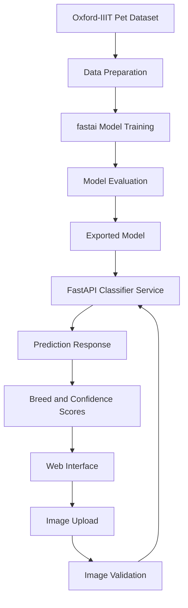

# Pets

An end-to-end deep learning application for identifying cat
and dog breeds from images.

Pets combines computer vision, transfer learning, REST API
development and a responsive web interface to deliver
real-time pet breed classification.


## Overview

Pets is a practical machine learning project that explores
the complete lifecycle of a deep learning application,
from model training and evaluation to backend integration
and frontend development.

The application allows users to upload an image of a cat
or dog and receive the three most likely breed predictions
with their corresponding model confidence scores.

## Features

- Classification of 37 different cat and dog breeds.
- Deep learning inference using fastai and PyTorch.
- REST API powered by FastAPI.
- Drag-and-drop image uploading.
- Image preview and client-side validation.
- Top-three breed predictions.
- Confidence score visualization.
- Model availability indicator.
- Loading and error handling states.
- Responsive user interface.
- Backend and frontend automated testing.

## Screenshots

Application screenshots will be added following the
initial deployment.

## Technology Stack

| Layer | Technologies |
|---|---|
| Machine Learning | Python, fastai, PyTorch |
| Model Architecture | ResNet-34 |
| Model Development | Jupyter Notebook |
| Backend | FastAPI, Uvicorn, Pydantic |
| Image Processing | Pillow |
| Frontend | HTML, Vanilla JavaScript |
| Styling | Tailwind CSS |
| Build Tool | Vite |
| Backend Testing | pytest, HTTPX, pytest-cov |
| Frontend Testing | Vitest, jsdom |
| Version Control | Git, GitHub |

## Architecture



## Dataset

The model uses the Oxford-IIIT Pet Dataset, a collection
of approximately 7,349 images representing 37 different
breeds of cats and dogs.

The dataset contains:

- 12 cat breeds.
- 25 dog breeds.
- Images with varying lighting, backgrounds and poses.

Dataset source:

https://www.robots.ox.ac.uk/~vgg/data/pets/

## Deep Learning Model

The model uses transfer learning with a pretrained
ResNet-34 convolutional neural network.

The machine learning workflow includes:

1. Dataset acquisition and exploration.
2. Image preprocessing and augmentation.
3. Training and validation data preparation.
4. Transfer learning and fine-tuning.
5. Model evaluation.
6. Model serialization and export.
7. Model inference through FastAPI.

### Model Performance

Detailed training metrics and evaluation results will be
documented after final model evaluation.

### Example Prediction

The following response was generated by the integrated
classification model:

```json
{
  "breed": "Beagle",
  "confidence": 0.9621317386627197,
  "predictions": [
    {
      "breed": "Beagle",
      "confidence": 0.9621317386627197
    },
    {
      "breed": "Basset Hound",
      "confidence": 0.024385787546634674
    },
    {
      "breed": "Shiba Inu",
      "confidence": 0.007599668111652136
    }
  ]
}
```

Confidence scores represent model estimates and should not
be interpreted as guaranteed prediction accuracy.

## Project Structure

```text
pets/
├── model/
│   ├── notebooks/
│   └── exports/
│       └── pets.pkl
│
├── backend/
│   ├── app/
│   │   ├── routes/
│   │   │   └── predictions.py
│   │   ├── services/
│   │   │   └── classifier.py
│   │   ├── config.py
│   │   ├── schemas.py
│   │   └── main.py
│   ├── tests/
│   │   ├── conftest.py
│   │   ├── test_health.py
│   │   ├── test_predictions.py
│   │   ├── test_classifier.py
│   │   └── test_integration.py
│   ├── pytest.ini
│   ├── requirements.txt
│   └── requirements-dev.txt
│
├── frontend/
│   ├── src/
│   │   ├── components/
│   │   │   ├── navbar.js
│   │   │   ├── hero.js
│   │   │   ├── upload.js
│   │   │   ├── results.js
│   │   │   └── footer.js
│   │   ├── services/
│   │   │   └── api.js
│   │   ├── utils/
│   │   │   └── validation.js
│   │   ├── main.js
│   │   └── styles.css
│   ├── tests/
│   ├── index.html
│   ├── vite.config.js
│   ├── package.json
│   └── package-lock.json
│
├── .gitignore
├── LICENSE
└── README.md
```

## Getting Started

### Prerequisites

- Python 3.12 or a compatible Python version.
- Node.js compatible with the installed Vite version.
- npm.
- Git.
- A trained fastai model exported as `pets.pkl`.

### Backend Setup

Navigate to the backend directory:

```bash
cd backend
```

Create a virtual environment:

```bash
python -m venv .venv
```

Activate the environment on Linux or macOS:

```bash
source .venv/bin/activate
```

Or on Windows PowerShell:

```powershell
.\.venv\Scripts\Activate.ps1
```

Install dependencies:

```bash
python -m pip install -r requirements.txt
```

Place the exported model at:

```text
model/exports/pets.pkl
```

The exported model is not included in Git because of its
file size. Train and export the model before performing
real inference.

Only load trusted model files.

Start the backend:

```bash
python -m uvicorn app.main:app --reload
```

The API will be available at:

http://localhost:8000

Interactive API documentation:

http://localhost:8000/docs

### Frontend Setup

Open a separate terminal:

```bash
cd frontend
npm ci
```

Create a `.env` file in the frontend directory:

```dotenv
VITE_API_URL=http://localhost:8000
```

Start the frontend:

```bash
npm run dev
```

The application will be available at:

http://localhost:5173

## API Reference

| Method | Endpoint | Description |
|---|---|---|
| GET | `/` | API welcome message |
| GET | `/health` | Application and model status |
| GET | `/breeds` | Supported pet breeds |
| POST | `/predict` | Classify an uploaded image |
| GET | `/docs` | Interactive API documentation |

### Health Check

```bash
curl http://localhost:8000/health
```

Example response:

```json
{
  "status": "ok",
  "model_loaded": true
}
```

### Image Classification

```bash
curl -X POST http://localhost:8000/predict \
  -F "file=@pet.jpg"
```

### Image Requirements

- Supported formats: JPEG, PNG and WEBP.
- Maximum file size: 5 MB (5 MiB).
- Maximum image dimensions: 20 megapixels.

## Automated Testing

The project includes automated testing for both the
backend and frontend.

### Backend Testing

The backend test suite covers:

- API health and availability.
- Image upload and validation.
- Prediction response schemas.
- Classifier functionality.
- Model availability.
- CORS configuration.
- Real-model integration.

Install development dependencies:

```bash
cd backend
python -m pip install -r requirements-dev.txt
```

Run all tests:

```bash
python -m pytest -v
```

Run tests without the trained model:

```bash
python -m pytest -v -m "not integration"
```

Generate a coverage report:

```bash
python -m pytest --cov=app --cov-report=term-missing
```

### Frontend Testing

The frontend test suite covers:

- Image validation.
- File size formatting.
- API communication.
- Network and timeout errors.
- Prediction result rendering.
- Navigation status indicators.
- Image upload interactions.
- Loading and accessibility states.

Run frontend tests:

```bash
cd frontend
npm test
```

Run tests in watch mode:

```bash
npm run test:watch
```

Generate a coverage report:

```bash
npm run test:coverage
```

### Test Suite

| Component | Test cases |
|---|---:|
| Backend | 17 |
| Frontend | 45 |
| Total | 62 |

Test counts describe the implemented test suite, rather
than a guarantee that every test passes in every environment.

## Production Build

Build the frontend:

```bash
cd frontend
npm run build
```

Preview the production build:

```bash
npm run preview
```

Generated frontend assets are stored in `frontend/dist/`.

## Limitations

- The model only supports breeds included in its training
  dataset.
- Mixed breeds may not be classified accurately.
- Non-pet images may still produce breed predictions.
- Model confidence does not guarantee correctness.
- Inference performance depends on available hardware.

## Roadmap

### Version 0.1.0 — Initial Release

- [x] Project initialization.
- [x] Dataset preparation.
- [x] Deep learning model training.
- [x] Model export and serialization.
- [x] FastAPI backend.
- [x] Image validation and preprocessing.
- [x] Model inference API.
- [x] Responsive frontend.
- [x] Frontend and backend integration.
- [x] Backend automated testing.
- [x] Frontend automated testing.
- [ ] Initial production deployment.
- [ ] Application screenshots.
- [ ] Publish model evaluation metrics.

### Version 0.2.0 — Reliability and Improvements

- [ ] End-to-end browser testing with Playwright.
- [ ] Continuous integration with GitHub Actions.
- [ ] Improved model evaluation.
- [ ] Unsupported image detection.
- [ ] Grad-CAM model visualization.
- [ ] Inference performance optimization.
- [ ] Docker support.

## Learning Resources

- [Practical Deep Learning for Coders](https://course.fast.ai/)
- [fastai Documentation](https://docs.fast.ai/)
- [PyTorch](https://pytorch.org/)
- [FastAPI](https://fastapi.tiangolo.com/)
- [Tailwind CSS](https://tailwindcss.com/)
- [Vite](https://vite.dev/)
- [pytest](https://docs.pytest.org/)
- [Vitest](https://vitest.dev/)

## Acknowledgements

- fast.ai for its open-source deep learning tools and
  educational resources.
- The creators of the Oxford-IIIT Pet Dataset.
- The PyTorch, FastAPI and JavaScript open-source
  communities.

## License

This project is licensed under the MIT License.
See the LICENSE file for details.
